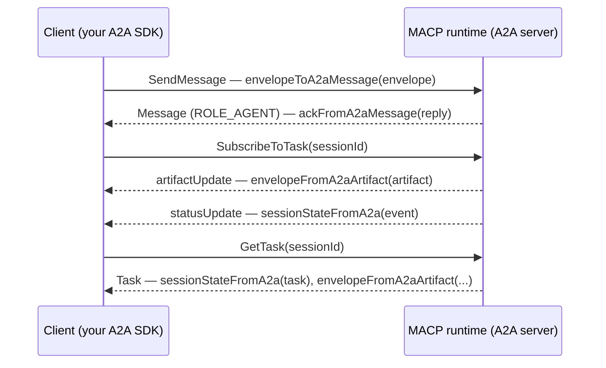

# A2A Binding

[RFC-MACP-0014](https://github.com/multiagentcoordinationprotocol/multiagentcoordinationprotocol/blob/main/rfcs/RFC-MACP-0014-a2a-binding.md)
(1.1.x) binds MACP to [A2A](https://a2a-protocol.org) 1.0. An agent that already speaks A2A reaches a
MACP runtime without a gRPC client:

- an Envelope travels as one Part of an A2A Message;
- the Ack comes back as an agent Message;
- an observer sees each accepted Envelope as an Artifact of the session's Task;
- the session state rides in Task metadata.

`src/a2a.ts` is the codec for that mapping. It turns SDK values into A2A JSON objects and back. It is a
pure wire binding: no A2A client or server, no transport, no session sealing or attestation, and no
dependency on an A2A SDK. It is Node-free, so it works in a browser, and is published as a subpath:

```typescript
import { envelopeToA2aMessage, ackFromA2aMessage } from 'macp-sdk-typescript/a2a';
// or from the package root: import { envelopeToA2aMessage } from 'macp-sdk-typescript';
```

The same functions exist in macp-sdk-python's `macp_sdk.a2a`, in snake_case (`envelope_to_a2a_message`),
and both SDKs pass the spec's 101 codec vectors.



## The functions

Envelopes are the `CanonicalEnvelope` of [`./canonical-json`](../../README.md#canonical-json): an `Envelope`
whose `payload` is a `Uint8Array`. Acks are the SDK's `Ack`.

| Function | Result |
|---|---|
| `envelopeToA2aPart(envelope, { encoding })` / `envelopeFromA2aPart(part, { maxPayloadBytes })` | An Envelope Part (§5.1) |
| `envelopeToA2aMessage(envelope, { encoding, messageId, contextId })` / `envelopeFromA2aMessage(message, { maxPayloadBytes })` | A `ROLE_USER` Message (§5.1, §6) |
| `ackToA2aMessage(ack, { messageId, taskId, contextId })` / `ackFromA2aMessage(message)` | A `ROLE_AGENT` Ack Message (§5.2) |
| `envelopeToA2aArtifact(envelope, sequence)` / `envelopeFromA2aArtifact(artifact, { maxPayloadBytes })` → `{ envelope, sequence }` | An Observation Artifact (§9.1) |
| `sessionStateToA2a(state)` → `{ taskState, metadata }` / `sessionStateFromA2a(taskOrEvent)` | Session state as Task state (§8) |
| `macpAgentExtension({ macpVersions, modes, required, manifestUrl })` | The AgentCard extension entry (§3) |
| `errorInfoFromA2a(errorOrDetails)` → `{ reason, domain, metadata, duplicate }` or `null` | The MACP ErrorInfo of an A2A error (§11, §12) |

Constants: `MACP_A2A_EXTENSION_URI`, `MEDIA_TYPE_ENVELOPE_JSON` (`application/macp-envelope+json`),
`MEDIA_TYPE_ENVELOPE_PROTO` (`application/macp-envelope+proto`), and `A2A_VERSION` (`'1.0'`, the
`A2A-Version` header value).

The types `A2aPart`, `A2aMessage`, `A2aArtifact`, `A2aTask` and `A2aAgentExtension` describe the A2A 1.0
JSON form, listing only the members the binding reads or writes.

## Sending an Envelope

```typescript
const message = envelopeToA2aMessage(envelope, { contextId: 'ctx-txn-48000' });
```

- **Encoding.** `encoding: 'json'` (the default) puts the canonical JSON Envelope in a `data` Part.
  `'proto'` puts the Protobuf Envelope, base64, in a `raw` Part. The JSON payload form follows
  RFC-MACP-0014 §5.3: a Core payload or one of a standard mode is a `payload` object, and anything else
  (every `ext.*` mode) is `payload_b64`.
- **`taskId`.** It is the session id, except on a `SessionStart` and a `Signal`, which have none:
  A2A doesn't let a client name a new Task (§6.1), and a Signal belongs to no session (§6.2).
- **`messageId`.** It defaults to the Envelope's `messageId` (§5.1). Pass `messageId` to set your own,
  for example on a retry. The runtime deduplicates on the Envelope's `message_id`, never the A2A one (§12).
- **`extensions`.** These list the extension URI. Your A2A client must also send the extension in the
  `A2A-Extensions` header, or the server answers `ExtensionSupportRequiredError` (§4).

## Reading an Ack

```typescript
const ack = ackFromA2aMessage(reply);
if (!ack.ok) console.log(ack.error?.code); // e.g. SESSION_NOT_OPEN
```

The Ack is the Part whose metadata has `<URI>/kind` set to `"ack"`. The decoder enforces that `error` is
present exactly when `ok` is false (§5.2). `ackToA2aMessage` is the server side; without a `messageId` it
generates a random UUID.

## Observing a session

`envelopeFromA2aArtifact` returns the Envelope and its `sequence`, the 1-based accepted-envelope ordinal
(RFC-MACP-0006 §3.2). `sequence` travels in a Struct, so the integral float `2.0` is accepted as `2`.
Anything missing, fractional or below 1 is refused.

**Dropping duplicates and detecting gaps is your job** (§9.2). The codec decodes one Artifact at a time:

```typescript
let last = 0;
for await (const event of stream) {
  if (event.artifactUpdate) {
    const { envelope, sequence } = envelopeFromA2aArtifact(event.artifactUpdate.artifact);
    if (sequence <= last) continue; // a redelivery
    if (sequence !== last + 1) await resync(last); // a gap: re-read the Task
    last = sequence;
    apply(envelope);
  }
  if (event.statusUpdate) console.log(sessionStateFromA2a(event.statusUpdate));
}
```

## Session state

OPEN and SUSPENDED both map to `TASK_STATE_WORKING`, so the exact state rides in the Task's metadata
under `<URI>/sessionState`, as a bare name (`OPEN`, not `SESSION_STATE_OPEN`):

| MACP | A2A TaskState | `<URI>/sessionState` |
|---|---|---|
| `SESSION_STATE_OPEN` | `TASK_STATE_WORKING` | `OPEN` |
| `SESSION_STATE_SUSPENDED` | `TASK_STATE_WORKING` | `SUSPENDED` |
| `SESSION_STATE_RESOLVED` | `TASK_STATE_COMPLETED` | `RESOLVED` |
| `SESSION_STATE_EXPIRED` | `TASK_STATE_FAILED` | `EXPIRED` |
| `SESSION_STATE_CANCELLED` | `TASK_STATE_CANCELED` | `CANCELLED` |

`sessionStateFromA2a` reads only that metadata, from a Task or from an unwrapped `TaskStatusUpdateEvent`
(`event.statusUpdate`, not the stream response around it). It never guesses from the TaskState: missing
metadata is an error. `SESSION_STATE_UNSPECIFIED` has no A2A form.

## Errors

Every decoder throws `MacpA2aError`, a `MacpSdkError`, with `layer` and `code`:

| `layer` | `code` | When | How a server answers |
|---|---|---|---|
| `a2a` | `INVALID_REQUEST` | A Message with two or more Envelope Parts | Rejects the request: JSON-RPC -32602 (§11.3) |
| `macp` | `INVALID_ENVELOPE` | The Envelope doesn't decode, the arm doesn't match the mediaType, the payload form is wrong, or `taskId` names another session | In band, in an Ack (§11.2) |
| `macp` | `PAYLOAD_TOO_LARGE` | The decoded payload exceeds `maxPayloadBytes` | In band, in an Ack (§5.4) |
| `codec` | `NOT_A_MACP_MESSAGE` | No Envelope Part, or no Ack Part | — |
| `codec` | `INVALID_ACK` | A malformed Ack Message | — |
| `codec` | `INVALID_SEQUENCE` | A bad Artifact `sequence` | — |
| `codec` | `INVALID_SESSION_STATE` | Missing or malformed session-state metadata, or UNSPECIFIED | — |

The `codec` codes are local to the SDKs; RFC-MACP-0014 gives them no wire code. Parts of other media
types are ignored, so a Message may carry a text Part beside its Envelope.

`maxPayloadBytes` (default 1048576, the runtime's `MACP_MAX_PAYLOAD_BYTES`) bounds the decoded payload
bytes, not the base64 text or the whole Envelope. A JSON `payload` is measured after its Protobuf
conversion. An oversized `payload_b64` is refused before it is decoded.

A JSON-RPC error from the server, or the bare details array of the HTTP+JSON and gRPC bindings, carries
the MACP code in a `google.rpc.ErrorInfo`:

```typescript
const info = errorInfoFromA2a(response.error);
if (info?.duplicate) {
  // §12: the runtime already accepted this message_id before the session ended
}
```

`duplicate` is true only for the string `"true"`, never the boolean.

## Declaring the extension

A runtime's AgentCard lists the extension under `capabilities.extensions`:

```typescript
const extension = macpAgentExtension({
  macpVersions: ['1.0'],
  modes: ['macp.mode.decision.v1', 'macp.mode.quorum.v1'],
  required: true,
  manifestUrl: 'https://runtime.example.com/.well-known/macp.json',
});
```

## Using an official A2A SDK

The codec's objects are the A2A 1.0 JSON form, so any A2A SDK can take them. With
[`@a2a-js/sdk`](https://www.npmjs.com/package/@a2a-js/sdk), convert through its generated types:

```typescript
import { Message } from '@a2a-js/sdk';

const sdkMessage = Message.fromJSON(envelopeToA2aMessage(envelope)); // the SDK's own Message
const ack = ackFromA2aMessage(Message.toJSON(sdkReply) as A2aMessage);
```

This SDK doesn't depend on `@a2a-js/sdk`; its tests use it, as a devDependency only, to check that every
Message, Artifact and AgentExtension the codec writes round-trips through the official types unchanged.

## Not covered

- **Server-side judgement.** The codec can't decide anything that needs the server's Task state, such as
  a `taskId` on a `SessionStart` (§11.3).
- **Negative zero.** A `-0` double has no vector yet (spec issue #246); the canonical-json unit tests
  cover it.
- **Conformance.** The spec's vectors are vendored under `tests/vectors/a2a/` and run by
  `tests/vectors/a2a.test.ts`. `tests/unit/a2a.test.ts` replays the RFC's example session end to end.
