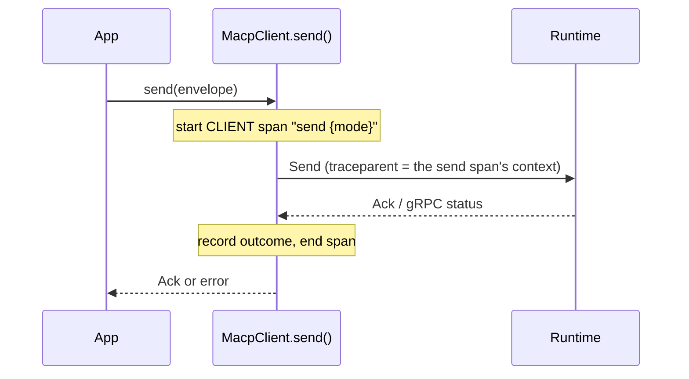

# Observability (OpenTelemetry)

The SDK can emit OpenTelemetry spans for `send()` and propagate W3C trace context to the runtime. It follows the MACP semantic conventions ([`docs/opentelemetry.md`](https://github.com/multiagentcoordinationprotocol/multiagentcoordinationprotocol/blob/main/docs/opentelemetry.md) in the spec repo; machine-readable registry `schemas/otel/macp-semconv.json`, vendored here as `tests/otel/macp-semconv.json`). The spans match `macp-sdk-python`: same span name, attributes and outcome rules, with the same shared test names.

## Opting in

`@opentelemetry/api` is an **optional peer dependency**. Install it, and register a tracer provider the usual way (for example `@opentelemetry/sdk-node`):

```bash
npm install @opentelemetry/api
```

There is no SDK flag. Without the package the SDK behaves exactly as before:
- It never loads any OpenTelemetry module. The `require` is lazy, runs on the first RPC, and its failure is remembered.
- It adds no metadata and emits nothing.

With the package installed but no provider registered, OpenTelemetry's no-op provider is the off switch: no span is recorded, and no `traceparent` is sent because no span context is valid.

The instrumentation scope is `macp-sdk-typescript` at the package version.

## The `send` span

`MacpClient.send()` creates one **CLIENT** span per call. The same goes for everything built on it: the session helpers, `sendSignal`, `sendProgress`, and each attempt of `retrySend`.



**Name:** `send {macp.mode.id}`, for example `send macp.mode.decision.v1`. When the mode is empty, as for an ambient Signal, the name is just `send`.

**Attributes:** exactly the semconv `span.macp.send` group, with no SDK-only extras.

| Attribute | When |
|---|---|
| `macp.operation.name` | always, `send` |
| `macp.message.id` | always |
| `macp.message.type` | always |
| `macp.session.id` | when the envelope's `sessionId` is non-empty |
| `macp.mode.id` | when `mode` is non-empty |
| `macp.sender.id` | when `sender` is non-empty. An empty sender is filled in by the runtime from auth, a value the SDK doesn't know. |
| `macp.version` | when `macpVersion` is non-empty |
| `macp.envelope.outcome` | when an outcome is known: `accepted`, `rejected` or `duplicate` |
| `error.type` | on a rejection or a failure (see below) |

**Outcome and status.** A rejection is a normal protocol outcome, so it never sets span status.

| What happened | `macp.envelope.outcome` | `error.type` | Span status |
|---|---|---|---|
| Ack `ok` | `accepted` | — | UNSET |
| Ack `duplicate` | `duplicate` | — | UNSET |
| NACK Ack (with or without `raiseOnNack`) | `rejected` | the Ack's `error.code`, or `_OTHER` if it's empty | UNSET |
| gRPC status the SDK raises as `MacpAckError`: a `macp-error-code` key (runtime ≥ 0.9.0), or the pre-0.9 `ALREADY_EXISTS`/`FAILED_PRECONDITION` fallback | `rejected` | `failure.code` | UNSET |
| Any other failure (`MacpTransportError`, deadline) | — | gRPC status name, such as `UNAVAILABLE` or `DEADLINE_EXCEEDED`, or `_OTHER` | ERROR, description = that same value |

The span is `rejected` exactly when `send()` raises `MacpAckError`, or with `raiseOnNack: false` would have raised it. A call that fails client-side before reaching the wire, for missing auth or an empty bearer token, emits no span.

### What is never recorded

The span records identifiers and types only. It never records:
- envelope payloads, decoded or not;
- `reason`, `rationale` or any other free text;
- commitment content;
- the message of an Ack error or an exception.

No exception events are recorded (no `recordException`). Span status descriptions carry the code only. The test `otel_no_payload_or_reason_recorded` enforces this.

Instrumentation never changes what `send()` returns or throws. A tracer or span that throws is swallowed.

## Trace context propagation

Per RFC-MACP-0006 §2.1, trace context travels **only in gRPC metadata**, never in the Envelope or in `SessionStartPayload.extensions`. Every RPC and stream the client opens adds:
- `traceparent`, when the active span context is valid;
- `tracestate`, when it is non-empty.

That includes calls made without auth, such as `getManifest`. On `Send`, the injected context is the send span's own, and the span is active for the duration of the call. The runtime's server span therefore becomes its child.

The headers are built directly from the span context, **not** through the global propagator. The two consequences:
- `baggage`, which can carry arbitrary user data, is never sent.
- A globally configured B3 or Jaeger propagator doesn't change what goes on the wire.

## Limitations

- **Streams.** On `openStream()`, every envelope sent on the stream inherits the context of the stream-open request. No per-envelope span is emitted. Use `send()` when you need a trace per envelope. This is the spec's documented limitation.
- **gRPC auto-instrumentation.** The `send` span is the active span while the RPC runs, so `@opentelemetry/instrumentation-grpc`, if you also run it, creates its gRPC client span as a child of `send`, as the semconv requires. It then injects its own `traceparent`, through the global propagator, which overwrites the SDK's. The runtime's server span therefore sits under the gRPC span, one level below `send`. Expect that extra level in the trace. Note also that the auto-instrumentation's propagator, unlike the SDK, may add `baggage`.
