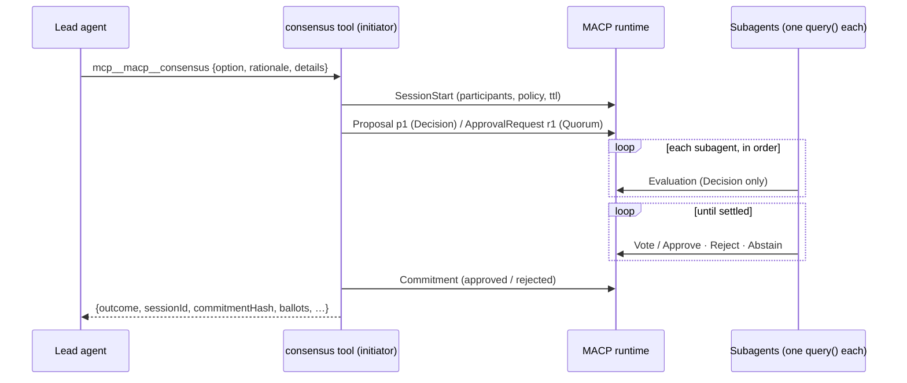

# @multiagentcoordinationprotocol/claude-agent-sdk

Let Claude Agent SDK subagents reach a binding, auditable decision.

A lead agent gets one tool, `mcp__macp__consensus`. When it calls the tool, the adapter opens a
[MACP](https://github.com/multiagentcoordinationprotocol) session on a MACP runtime. Each reviewer
subagent evaluates the proposal in its own Claude `query()`, under its own MACP identity, and then
votes. The runtime enforces the protocol and its governance policy and commits the outcome. The
lead reads back the **commitment**: the outcome, the session id, and an RFC-MACP-0013 content
hash. One call turns that result into a verifiable [decision receipt](#decision-receipts).

You can also skip the lead agent and call `macpConsensus` from code.

The Python package [`claude-agent-sdk-macp`](https://github.com/multiagentcoordinationprotocol/macp-sdk-python/tree/main/integrations/claude-agent-sdk)
implements the same contract: the same options, schema, ballot mapping and commitment shape. The
consensus engine is the one behind
[`@multiagentcoordinationprotocol/langgraph`](../langgraph/).

```bash
npm install @multiagentcoordinationprotocol/claude-agent-sdk @anthropic-ai/claude-agent-sdk zod
```

It needs Node ≥ 20, a MACP runtime ≥ 0.9.0, and `ANTHROPIC_API_KEY` (or any other auth the
Claude Agent SDK accepts) for the agents. The package is ESM-only, like the Agent SDK.
`macp-sdk-typescript` comes in as a dependency. For local development, start a runtime with:

```bash
docker run -d -p 50051:50051 -e MACP_BIND_ADDR=0.0.0.0:50051 \
  -e MACP_ALLOW_INSECURE=1 -e MACP_MEMORY_ONLY=1 \
  ghcr.io/multiagentcoordinationprotocol/macp-runtime:0.9.0
```

## Quick start: a lead agent and a review board

```ts
import { query } from '@anthropic-ai/claude-agent-sdk';
import { Auth, MacpClient } from 'macp-sdk-typescript';
import { macpConsensusServer } from '@multiagentcoordinationprotocol/claude-agent-sdk';

const client = new MacpClient({
  address: 'localhost:50051',
  secure: false,
  allowInsecure: true, // dev runtime only
  auth: Auth.devAgent('lead-agent'),
});

const macp = macpConsensusServer({
  client,
  agents: {
    'fraud-agent': { description: 'Fraud analyst', prompt: 'You are a fraud analyst. …' },
    'risk-agent': { description: 'Risk analyst', prompt: 'You are a risk analyst. …' },
    'compliance-agent': { description: 'Compliance officer', prompt: 'You are a compliance officer. …' },
  },
});

for await (const message of query({
  prompt: 'A customer asks for a refund of order 9 ($120, charged twice). Decide with the review board.',
  options: {
    model: 'claude-opus-5-5',
    mcpServers: { macp },
    allowedTools: ['mcp__macp__consensus'],
  },
})) {
  // The lead calls mcp__macp__consensus({ option, rationale?, details? }) and receives
  // { outcome: 'approve' | 'reject', sessionId, commitmentHash, approvals, threshold, ballots, … }
}
```

## Without a lead agent

```ts
import { macpConsensus } from '@multiagentcoordinationprotocol/claude-agent-sdk';

const result = await macpConsensus(
  { client, mode: 'quorum', threshold: 2, agents: { security: { … }, sre: { … }, product: { … } } },
  { option: 'deploy v2.4.0 to production', rationale: 'fixes checkout', details: { tests: 'green' } },
);
result.outcome; // 'approve' | 'reject'
result.commitmentHash; // 'sha256:…'
```

## How a run works



- **The initiator** is the identity on `client`. It opens and commits the session and never votes.
  In Decision mode it's also declared as a session participant, because only participants may
  propose. In Quorum mode it's left off the participant list.
- **Subagents** run in-process, one fresh `query()` per evaluation. Each sends as its own MACP
  identity: its `auth`, which defaults to `Auth.devAgent(id)` (dev runtimes only). On a production
  runtime, give each agent a real bearer credential: `agents: { risk: { …, auth: Auth.bearer(token) } }`.
- **Decision mode** (the default): every subagent evaluates before anyone votes, following
  RFC-MACP-0007's two phases. By default each one votes its own evaluation; pass `voter` on an
  agent to change that.
- **Quorum mode**: each subagent's evaluation becomes its ballot directly.
- **Settling**: the session commits as soon as the outcome is decided. It approves once approvals
  reach `threshold`, and rejects once they no longer can. Remaining subagents aren't asked.
- **Failures**: if anything goes wrong after the session starts, the session is cancelled (best
  effort). `macpConsensus` rethrows the original error; the tool returns it to the lead as a tool
  error (`isError`, `"consensus failed: …"`). This covers a refused message, a policy denial on
  commit, a transport error, or a Claude run that ends in error (auth, max turns, budget). An
  answer that doesn't validate isn't an error: it becomes a `REVIEW` with confidence 0.

### Ballot mapping

| Evaluation `recommendation` | Sent as Evaluation | Decision vote | Quorum ballot |
| --------------------------- | ------------------ | ------------- | ------------- |
| `APPROVE`                   | `APPROVE`          | `APPROVE`     | Approve       |
| `REVIEW`, `ABSTAIN`         | `REVIEW`           | `ABSTAIN`     | Abstain       |
| `REJECT`                    | `REJECT`           | `REJECT`      | Reject        |
| `BLOCK`                     | `BLOCK`            | `REJECT`      | Reject        |

## The Claude evaluator

`claudeEvaluator(agent, options?)` runs an `AgentDefinition` as an evaluator. `agents` uses it for
every entry; you can also use it directly in `participants: [{ id, evaluator }]`, mixed with
evaluators that don't call a model.

Each evaluation is one `query()` with:

| Query option                       | Value                                                                                     |
| ---------------------------------- | ----------------------------------------------------------------------------------------- |
| `systemPrompt`                     | `agent.prompt`, then `EVALUATOR_INSTRUCTIONS`                                             |
| prompt                             | the proposal as JSON: `{ proposalId, option, rationale, details, mode }`                  |
| `model`                            | `agent.model`, else `options.model`, else `claude-opus-5-5` (`'inherit'` counts as unset) |
| `maxTurns`                         | `agent.maxTurns`, else `options.maxTurns`, else 4                                         |
| `tools`                            | `agent.tools`, else none                                                                  |
| `outputFormat`                     | JSON schema `EVALUATION_SCHEMA`: `{ recommendation, confidence, reason }`                 |
| `settingSources`, `persistSession` | `[]`, `false`: no filesystem settings or CLAUDE.md, no saved session                      |

`agent.disallowedTools` and a string `agent.effort` pass through. `options.queryOptions` is applied
last and overrides any of these (for example `env`, `abortController` or `mcpServers`).
`options.query` replaces the SDK's `query`, which is how the tests run without an API key.

The structured output is read first, then the result text (a ` ```json ` fence is stripped). An
unknown recommendation, or a confidence outside [0, 1], becomes `REVIEW` / 0 /
`"unparseable model output"`. A result with an error subtype or `is_error` throws `MacpSdkError`.

## Options

`macpConsensusServer(options)` checks its options when it's built, so a misconfigured server throws
a `TypeError` before any agent runs. `macpConsensus(options, proposal)` takes the same options,
apart from `name` and `onResult`.

| Option         | Default            |                                                                        |
| -------------- | ------------------ | ---------------------------------------------------------------------- |
| `client`       | required           | A `MacpClient` authenticated as the initiator.                         |
| `agents`       | one of these two   | `{ [id]: AgentDefinition & { auth?, voter? } }`, in key order.         |
| `participants` | one of these two   | `[{ id, evaluator, voter?, auth? }]`, as in the LangGraph adapter.     |
| `evaluator`    |                    | `ClaudeEvaluatorOptions` applied to every agent.                       |
| `mode`         | `'decision'`       | `'decision'` or `'quorum'`.                                            |
| `policy`       | `policy.default`   | The `policy_version` of a governance policy registered on the runtime. |
| `threshold`    | `floor(n/2)+1`     | Approvals needed, between 1 and n.                                     |
| `ttlMs`        | `60000`            | Session TTL.                                                           |
| `action`       | `'macp.consensus'` | Committed as `${action}.approved` / `${action}.rejected`.              |
| `initiator`    | from `client.auth` | The initiator's agent id, if the credential doesn't carry it.          |
| `name`         | `'macp'`           | MCP server name; the tool is `mcp__<name>__consensus`.                 |
| `onResult`     |                    | Called with each committed result, e.g. to store a receipt.            |

Ids must be unique and differ from the initiator. `consensusTool(options)` returns the tool
definition alone, to mount on a server you build yourself.

### The result

```ts
{
  outcome: 'approve' | 'reject',
  sessionId: string,
  commitmentHash: 'sha256:…', // RFC-MACP-0013, over `commitment`
  mode: 'macp.mode.decision.v1' | 'macp.mode.quorum.v1',
  commitment: CommitmentPayload, // exactly what the runtime accepted
  approvals: number,
  threshold: number,
  ballots: [{ participant, vote, reason }],
}
```

The tool returns this as JSON text and as `structuredContent`. The commitment's `reason` is
`"<approvals>/<n> approvals (threshold <t>)"`, and its `authorityScope` is `macp.consensus`.

## Decision receipts

```ts
import { consensusReceipt } from '@multiagentcoordinationprotocol/claude-agent-sdk';
import { verifyReceipt } from 'macp-sdk-typescript/receipt';

const receipt = consensusReceipt(result, { issuer: 'support-lead' });
verifyReceipt(receipt, {}).verdict; // 'integrity_only'
```

`consensusReceipt(result, { issuer, issuedAt?, signer? })` builds the RFC-MACP-0013 Appendix A
`macp-receipt/1`. `issuedAt` defaults to now, at second precision. Pass a `signer`
(`{ kid, privateKey }`, Ed25519) to add a JWS attestation that verifies as `attested`.

## Examples

Both need `ANTHROPIC_API_KEY` and a runtime at `MACP_RUNTIME_ADDRESS` (default `localhost:50051`).

- [`examples/review-board.ts`](examples/review-board.ts): a support lead (`claude-opus-5-5`)
  puts a refund to fraud, risk and compliance subagents through `mcp__macp__consensus`, then
  answers the customer. Prints the ballots, the commitment hash and the receipt verdict.
- [`examples/direct-consensus.ts`](examples/direct-consensus.ts): `macpConsensus` from code, as
  a 2-of-3 quorum on a Friday deploy, with one reviewer on `claude-sonnet-5-5`.

```bash
npx tsx examples/review-board.ts
```

## More frameworks

The same consensus is available as a LangGraph node in
[`@multiagentcoordinationprotocol/langgraph`](../langgraph/). An OpenAI Agents SDK adapter will
follow.

## Development

```bash
npm ci
npm run check && npm run format:check && npm test   # unit tests, no runtime, no API key
MACP_RUNTIME_ADDRESS=localhost:50051 npm run test:integration
```

The integration tests stand a scripted `query` in for Claude, so they need no key. A live test
also runs when `ANTHROPIC_API_KEY` is set.

This package is versioned and released on its own from the macp-sdk-typescript repo. Its tags
look like `claude-agent-sdk-v0.1.0`.
