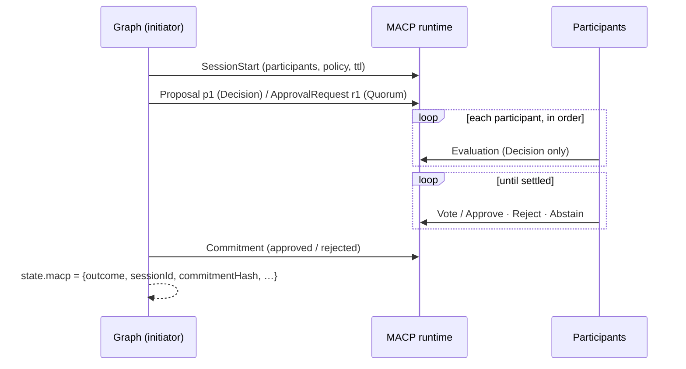

# @multiagentcoordinationprotocol/langgraph

Add a binding, auditable multi-agent decision to a LangGraph graph in a few lines.

`MacpConsensusNode` is an ordinary LangGraph node. When the graph reaches it, it opens a
[MACP](https://github.com/multiagentcoordinationprotocol) session on a MACP runtime. Each
participant agent evaluates the proposal, usually with its own LLM, and then votes. The runtime
enforces the protocol and its governance policy. The node then writes the **commitment** into
graph state: the outcome, the session id, and an RFC-MACP-0013 content hash. Downstream nodes
branch on `state.macp.outcome`, and one call turns the result into a verifiable
[decision receipt](#decision-receipts).

The Python package [`langgraph-macp`](https://github.com/multiagentcoordinationprotocol/macp-sdk-python/tree/main/integrations/langgraph)
implements the same contract: the same options, state keys, ballot mapping and commitment shape.

```bash
npm install @multiagentcoordinationprotocol/langgraph @langchain/langgraph @langchain/core
```

It needs Node ≥ 20 and a MACP runtime ≥ 0.9.0. `macp-sdk-typescript` comes in as a dependency.
For local development, start a runtime with:

```bash
docker run -d -p 50051:50051 -e MACP_BIND_ADDR=0.0.0.0:50051 \
  -e MACP_ALLOW_INSECURE=1 -e MACP_MEMORY_ONLY=1 \
  ghcr.io/multiagentcoordinationprotocol/macp-runtime:0.9.0
```

## Quick start

```ts
import { Annotation, END, START, StateGraph } from '@langchain/langgraph';
import { ChatAnthropic } from '@langchain/anthropic';
import { Auth, MacpClient } from 'macp-sdk-typescript';
import { MacpConsensusNode, llmEvaluator, type ConsensusResult } from '@multiagentcoordinationprotocol/langgraph';

const client = new MacpClient({
  address: 'localhost:50051',
  secure: false,
  allowInsecure: true, // dev runtime only
  auth: Auth.devAgent('coordinator'),
});
const model = new ChatAnthropic({ model: 'claude-opus-5-5' });

const State = Annotation.Root({
  proposal: Annotation<string>(),
  macp: Annotation<ConsensusResult>(),
});

const graph = new StateGraph(State)
  .addNode(
    'consensus',
    MacpConsensusNode({
      client,
      participants: [
        { id: 'fraud-agent', evaluator: llmEvaluator(model, { systemPrompt: 'You are a fraud analyst. …' }) },
        { id: 'risk-agent', evaluator: llmEvaluator(model, { systemPrompt: 'You are a risk analyst. …' }) },
        { id: 'compliance-agent', evaluator: llmEvaluator(model, { systemPrompt: 'You are a compliance officer. …' }) },
      ],
    }),
  )
  .addEdge(START, 'consensus')
  .addEdge('consensus', END)
  .compile();

const { macp } = await graph.invoke({ proposal: 'refund order 9' });
macp.outcome; // 'approve' | 'reject'
macp.commitmentHash; // 'sha256:…'
```

An evaluator can be any `EvaluationStrategy` from `macp-sdk-typescript`'s agent framework, or a
plain function. Evaluators don't have to call an LLM, so the same graph runs deterministically in
tests:

```ts
{ id: 'risk-agent', evaluator: (proposal) => ({ recommendation: 'APPROVE', confidence: 0.8, reason: 'within limits' }) }
```

## How a run works



- **The initiator** is the identity on `client`. It opens and commits the session and never votes.
  In Decision mode it's also declared as a session participant, because only participants may
  propose. In Quorum mode it's left off the participant list: it only sends the ApprovalRequest
  and the Commitment.
- **Participants** run in-process. Each sends as its own MACP identity, `auth`, which defaults to
  `Auth.devAgent(id)` (dev runtimes only). On a production runtime, give each one a real bearer
  credential.
- **Decision mode** (the default): every participant evaluates before anyone votes, following
  RFC-MACP-0007's two phases. By default each participant votes its own evaluation; pass `voter`
  (a `VotingStrategy`) to change that.
- **Quorum mode**: each participant's evaluation becomes its ballot directly.
- **Settling**: the node commits as soon as the outcome is decided. It approves once approvals
  reach `threshold`, and rejects once they no longer can (abstentions count as ballots without
  approval). Remaining participants aren't asked.
- **Failures**: if anything goes wrong after the session starts, the node cancels the session
  (best effort) and rethrows the original error, with nothing written to state. This covers a
  refused message, a policy denial on commit, a transport error, or an evaluator that throws. An
  LLM answer that doesn't parse isn't an error: it becomes a `REVIEW` with confidence 0.

### Ballot mapping

| Evaluation `recommendation` | Sent as Evaluation | Decision vote | Quorum ballot |
| --- | --- | --- | --- |
| `APPROVE` | `APPROVE` | `APPROVE` | Approve |
| `REVIEW`, `ABSTAIN` | `REVIEW` | `ABSTAIN` | Abstain |
| `REJECT` | `REJECT` | `REJECT` | Reject |
| `BLOCK` | `BLOCK` | `REJECT` | Reject |

Recommendations are case-insensitive. Any other value is refused before it's sent.

## Options

`MacpConsensusNode(options)` checks its options when it's built, so a misconfigured node throws a
`TypeError` while you assemble the graph, not mid-run.

| Option | Default | |
| --- | --- | --- |
| `client` | required | A `MacpClient` authenticated as the initiator. |
| `participants` | required | `[{ id, evaluator, voter?, auth? }]`. Ids must be unique and differ from the initiator. |
| `mode` | `'decision'` | `'decision'` or `'quorum'`. |
| `policy` | `policy.default` | The `policy_version` of a governance policy registered on the runtime. |
| `threshold` | `floor(n/2)+1` | Approvals needed, between 1 and n. |
| `ttlMs` | `60000` | Session TTL. |
| `action` | `'macp.consensus'` | Committed as `${action}.approved` / `${action}.rejected`. |
| `proposal` | `state.proposal` | `(state) => string \| { option, rationale?, details? }`. |
| `outputKey` | `'macp'` | The state key the result is written to. |
| `initiator` | from `client.auth` | The initiator's agent id, if the credential doesn't carry it. |

Each evaluator receives `{ proposalId, option, rationale, details, mode }`. The `proposalId` is
`p1` in Decision mode and `r1` in Quorum mode, and `details` is your object or `null`.

### The result in state

```ts
{
  outcome: 'approve' | 'reject',
  sessionId: string,
  commitmentHash: 'sha256:…', // RFC-MACP-0013, over `commitment`
  mode: 'macp.mode.decision.v1' | 'macp.mode.quorum.v1',
  commitment: CommitmentPayload, // exactly what the runtime accepted
  approvals: number,
  threshold: number,
  ballots: [{ participant, vote, reason }],
}
```

Everything in the result is plain JSON, so it survives LangGraph checkpointers. The commitment's
`reason` is `"<approvals>/<n> approvals (threshold <t>)"`, and its `authorityScope` is
`macp.consensus`.

## LLM evaluators

`llmEvaluator(model, { systemPrompt? })` turns any LangChain chat model into an evaluator. The
model receives the system prompt and the proposal as JSON, and must answer with
`{"recommendation", "confidence", "reason"}`. A ` ```json ` fence is stripped. If the answer
doesn't parse, or has an unknown recommendation or a confidence outside [0, 1], the evaluator
returns `REVIEW` with confidence 0 and reason `"unparseable model output"`. A model call that
throws, such as an auth or network error, fails the run.

Use `FakeListChatModel` from `@langchain/core/utils/testing` to test a graph without an API key.

## Decision receipts

```ts
import { consensusReceipt } from '@multiagentcoordinationprotocol/langgraph';
import { verifyReceipt } from 'macp-sdk-typescript/receipt';

const receipt = consensusReceipt(state.macp, { issuer: 'my-service' });
verifyReceipt(receipt, {}).verdict; // 'integrity_only'
```

`consensusReceipt(result, { issuer, issuedAt?, signer? })` builds the RFC-MACP-0013 Appendix A
`macp-receipt/1` for the decision. `issuedAt` defaults to now, at second precision. Pass a
`signer` (`{ kid, privateKey }`, Ed25519) to add a JWS attestation; anyone holding the matching
public key can then verify the receipt as `attested`.

## Examples

- [`examples/consensus-graph.ts`](examples/consensus-graph.ts): a fraud-review graph
  (signals → consensus → act). Three deterministic agents use the fraud scoring from
  macp-playground's LangGraph worker, so it needs no API key. Run it with
  `npx tsx examples/consensus-graph.ts [clean|borderline|fraudulent]`.
- [`examples/llm-consensus.ts`](examples/llm-consensus.ts): the same review with three
  Claude-backed reviewers (`claude-opus-5-5`). It needs `ANTHROPIC_API_KEY` and
  `npm i @langchain/anthropic`.

## More frameworks

[`@multiagentcoordinationprotocol/claude-agent-sdk`](../claude-agent-sdk/) runs the same
consensus with Claude Agent SDK subagents as the participants. An OpenAI Agents SDK adapter will
follow.

## Development

```bash
npm ci
npm run check && npm run format:check && npm test   # unit tests, no runtime
MACP_RUNTIME_ADDRESS=localhost:50051 npm run test:integration
```

This package is versioned and released on its own from the macp-sdk-typescript repo. Its tags
look like `langgraph-v0.1.0`.
